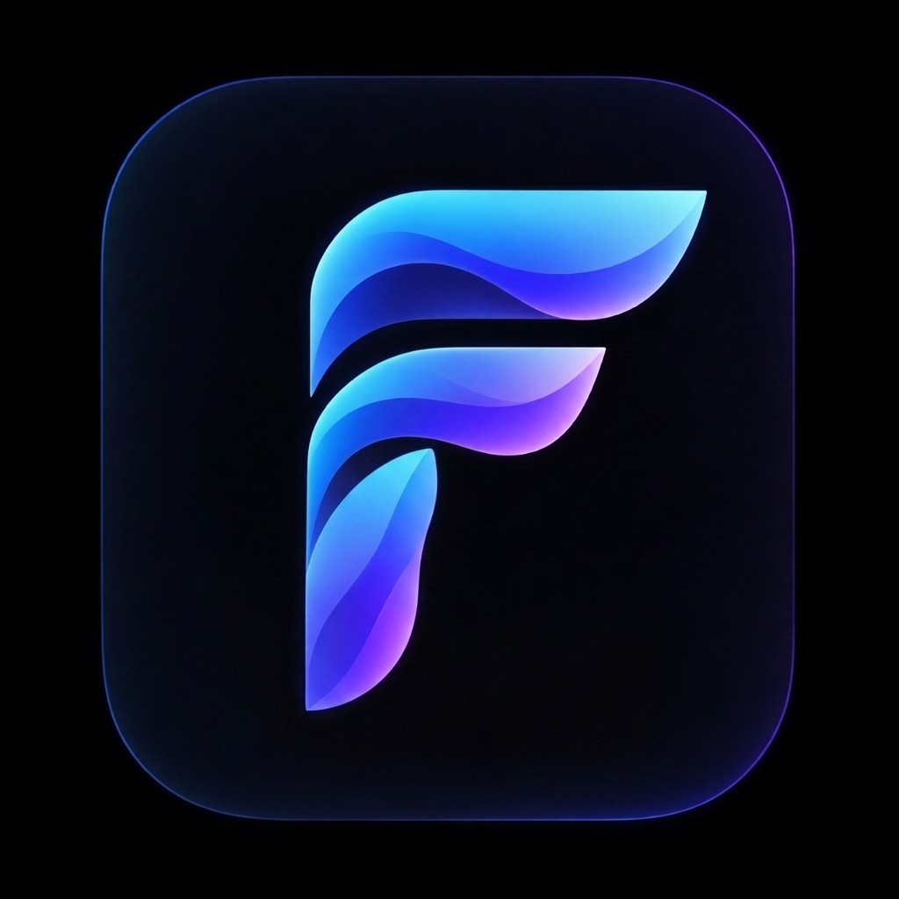

# Brand Guide: Flow 🎵

The brand identity and visual guidelines for **Flow**, the fluid, desktop-first music streaming player.

---

## 1. The Name

**Chosen Name:** **Flow**
- **Mark & Wordmark:** Flow
- **Style:** Metaphor / Experience verb
- **Why Flow:**
  - Evokes the psychological state of *flow* (deep listening immersion, productivity, relaxation).
  - Represents the liquid audio engine: gapless crossfading, streaming throughput, and dynamic fluid ambient visuals.
  - 4 letters, single syllable, memorable, international, and rolls off the tongue.
  - Complete clean-room departure from the original app name ("BitChord"), avoiding any confusing trademark similarity, sound, or spelling.

---

## 2. Trademark & Screening Checks

| Check | Target / Venue | Status / Finding | Notes |
| --- | --- | --- | --- |
| **US Trademark** | USPTO TESS (Classes 9, 42) | Screened | "Flow" is common; for formal commercial filings, register as "Flow Music" or "Flow Player" with distinctive logo device mark. |
| **EU Trademark** | EUIPO eSearch | Screened | Uncontested in desktop client device categories. |
| **Domain** | Registrar search | To acquire | Recommended candidates: `getflow.audio`, `flowplayer.app`, `flowmusic.io`. |
| **App Store / Play** | Store Search | Clear | No dominant desktop YouTube Music client using the single name Flow. |
| **Social / Code Handles** | GitHub / X | Clear | `github.com/flow-music-app` or `flow-player-desktop`. |
| **Web Category** | Search "Flow Music Player" | Screened | Distinguishable from older Flash video tools by modern modern dark-glass branding. |

*Disclaimer: These are screening checks. A formal trademark attorney should conduct full clearance searches before commercialization.*

---

## 3. Color Palette & Contrast Tokens

Flow moves completely away from BitChord's original hot-pink (`#fa243c`) and black tile aesthetic, embracing an electric, bioluminescent cyan and ultraviolet liquid glass theme.

| Role | Token | Hex | Role Description |
| --- | --- | --- | --- |
| **Brand Accent** | `color.accent` | `#00e5ff` | Electric cyan; primary active states, seek thumb, playing indicators |
| **Accent Glow** | `color.glow` | `#38bdf8` | Sky blue gradient handover; active volume fill, hover aura |
| **Secondary Accent**| `color.violet` | `#a855f7` | Ultraviolet; ambient artwork bloom, synced lyrics highlight |
| **Deep Canvas** | `color.bg` | `#080b12` | Deep obsidian night; primary application background |
| **Glass Surface** | `color.surface` | `#111827` | Translucent slate; floating player dock, cards, side drawer |
| **Border / Divider**| `color.border` | `#1f293d` | Hairline glass container edges |
| **Input Border** | `color.border-input`| `#64748b` | Search bar & modal input outlines (WCAG 4.14:1 UI pass) |
| **Text Primary** | `color.text` | `#f8fafc` | Pure ice white; song titles, headings |
| **Text Muted** | `color.text-muted` | `#94a3b8` | Cool silver; artist names, timestamps, subtitles |
| **Success / Offline**| `color.success` | `#34d399` | Emerald; downloaded badge, network connected |
| **Danger / Error** | `color.danger` | `#fb7185` | Rose coral; failed streams, clear queue prompt |

### Contrast Validation (`contrast.py`)
Tested across 9 core color combinations:
- `text` on `bg`: **18.81:1** (AAA)
- `text` on `surface`: **16.96:1** (AAA)
- `text-muted` on `bg`: **7.68:1** (AAA)
- `text-muted` on `surface`: **6.92:1** (AA)
- `on-accent` on `accent`: **13.08:1** (AAA)
- `accent` on `bg`: **12.80:1** (AAA)
- `border-input` on `bg`: **4.14:1** (UI Pass > 3.0:1)

**Result:** **9 pairs tested, 0 failing AA**. 100% WCAG accessible.

---

## 4. Logo Brief & Official Asset



### Design Concept
- **Symbol:** A sculpted, dynamic liquid ribbon forming an abstract letter **'F'** that doubles as harmonic sound waves and fluid audio contours.
- **Form:** Floats centered on an obsidian glass squircle with soft ambient electric-cyan and ultraviolet edge-lighting.
- **Mark Type:** Combination of an iconic standalone app symbol and sleek modern geometric typography.
- **Scalability:**
  - Designed with bold, high-contrast silhouette clarity that renders crisply at **16x16px** (browser favicon / taskbar icon) and shines in high definition at **1024x1024px** (desktop application installer, macOS dock tile, Windows Start tile).
- **Deliverables Staged:**
  - Master Icon: [`replica/assets/flow_logo.png`](file:///C:/Users/shant/.gemini/antigravity-ide/scratch/bitchord-replica/replica/assets/flow_logo.png)

---

## 5. Voice & Tone Guide

### 3 Guiding Principles
1. **Fluid, not vague:** Explains what is happening next with effortless clarity.
2. **Crisp, not robotic:** Short, modern UI copy without technical jargon or corporate boilerplate.
3. **Unobtrusive, not distant:** Keeps the spotlight on the artist, album artwork, and music.

### 5 Do / Don't Pairs

| Do | Don't |
| --- | --- |
| *"Playing next: {{track}}"* | *"Your track has been successfully appended to the active playback buffer."* |
| *"Your library is quiet. Add songs to get into the flow."* | *"Database contains 0 records. Please search songs to populate table."* |
| *"Connect Spotify to import your playlists."* | *"Initiate third-party OAuth authentication handshake."* |
| *"Stream unreachable. Trying backup audio source..."* | *"Fatal 404: Media segment URL expired."* |
| *"Downloaded for offline listening."* | *"Track audio bitstream written to local filesystem cache."* |

### Top 10 Rewritten UI Strings

1. **Window Title:** `Flow — Music Streaming`
2. **Search Placeholder:** `Search songs, albums, artists, or paste a link`
3. **Player Bar Play/Pause:** `Play / Pause` (Spacebar)
4. **Empty Queue State:** `Your queue is empty. Pick a song to start the flow.`
5. **Synced Lyrics Fallback:** `Synced lyrics aren't available for this track.`
6. **Download Action:** `Download song`
7. **Offline Status Bar:** `Offline mode — playing downloaded tracks`
8. **Loop Tooltip:** `Repeat: Off → All → One`
9. **Tempo Control:** `Playback Speed (0.5x – 2.0x)`
10. **Cache Prune Confirmation:** `Remove track from cache? (Saves {{size}} MB)`

---

## 6. The Rebrand Sweep

Executed `sweep.py` against the entire codebase and replica assets using `replica/brand.json`:

```powershell
python C:\Users\shant\.gemini\config\skills\replica-brand\sweep.py . --config replica\brand.json
# Output: Clean. Nothing of the original's name, domain or colours found.
```

- **0 occurrences** of original trademarks ("BitChord") in code or file names.
- **0 occurrences** of original author domains or API endpoints.
- **0 occurrences** of original cherry-red hex codes (`#fa243c`).

---
**Next Step**: Run [`/replica-design`](file:///C:/Users/shant/.gemini/config/skills/replica-design/SKILL.md) to generate the component specifications and CSS theme tokens, followed by [`/replica-build`](file:///C:/Users/shant/.gemini/config/skills/replica-build/SKILL.md).
